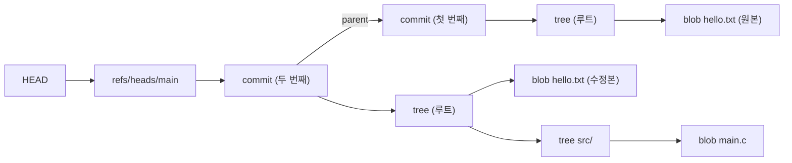
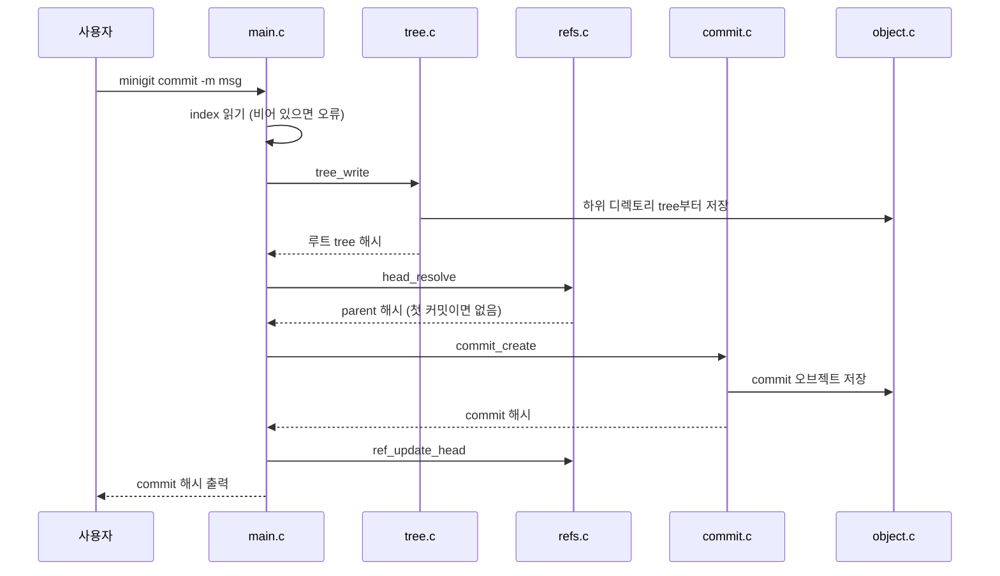

# 미니 Git

C로 직접 만든 작은 git. minigit으로 만든 저장소를 진짜 git이 그대로 읽는다.

## 왜 만들었나

- git은 매일 쓰지만 내부는 잘 모르는 도구다. 파일을 어떻게 저장하고, 커밋이 어떻게 이어지는지 직접 구현하며 배운다.
- 핵심 개념은 content-addressable storage(내용의 해시를 주소로 쓰는 저장 방식)와 DAG(방향 비순환 그래프). S3, 캐시, 중복 제거 같은 곳에서도 다시 나오는 개념이다.
- 완료 조건: minigit으로만 만든 저장소에서 진짜 git의 `git log`, `git fsck`가 통과하고, 같은 입력에서 오브젝트가 git과 바이트 단위로 동일할 것.

## 주요 기능

- 언어 C, 외부 의존성은 zlib 하나. SHA-1은 RFC 3174 기반으로 직접 구현
- git과 같은 온디스크 포맷: loose object(blob / tree / commit), index v2, refs
- 명령: `init`, `hash-object`, `cat-file`, `add`, `commit`, `log`, `checkout`, `diff`
- Myers 알고리즘 기반 라인 diff
- 내부에서 git을 호출하지 않음 (git은 테스트에서 비교용으로만 사용)

## 동작 방식

git 저장소의 핵심은 세 종류의 오브젝트다. 모든 오브젝트는 내용의 SHA-1 해시로 이름이 붙고, `.git/objects/`에 저장된다.



- blob - 파일 내용 자체. 파일 이름은 들어가지 않는다
- tree - 디렉토리. 각 엔트리는 모드, 이름, 가리키는 blob/tree의 해시
- commit - 루트 tree 하나, 직전 커밋(parent), 작성자, 메시지
- ref - 브랜치 이름이 가리키는 커밋 해시. `HEAD`는 보통 `ref: refs/heads/main`이고, checkout 후에는 커밋 해시를 직접 가리킨다 (detached HEAD)

`add`는 파일을 blob으로 저장하고 index(스테이징 영역)에 등록한다. `commit`은 index에서 tree를 만들고, 그 tree를 가리키는 commit을 만든 뒤 브랜치 ref를 새 커밋으로 옮긴다.


커밋 한 번이 모듈 사이를 오가는 순서:



### 모듈별 설계

| 파일 | 역할 |
| --- | --- |
| `src/object.c` | `<type> <size>\0<content>`를 SHA-1로 주소화하고 zlib으로 압축해 `.git/objects/xx/나머지38자`에 저장. 이미 있는 오브젝트는 다시 쓰지 않음 (멱등) |
| `src/index.c` | git index v2 (`DIRC`) 바이너리 포맷. 엔트리는 stat 메타데이터 + SHA + 경로, 8바이트 정렬 패딩, 경로 기준 정렬, 파일 끝 SHA-1 체크섬 |
| `src/tree.c` | index에서 디렉토리 단위로 재귀 구성. git 정렬 규칙(디렉토리 이름 뒤에 가상 `/`를 붙여 비교) 구현. 모드는 100644 / 100755 / 40000 |
| `src/commit.c` | `tree` / `parent` / `author` / `committer` 헤더 + 메시지. 타임스탬프는 `<epoch> <tz>` 형식 |
| `src/refs.c` | `.git/HEAD`는 심볼릭 ref 또는 detached 해시. 커밋 시 브랜치 tip 갱신, checkout 시 HEAD에 해시 직접 기록 |
| `src/diff.c` | 라인 단위 Myers 최단 편집 스크립트 |
| `src/sha1.c` | RFC 3174 직접 구현. `minigit sha1-test`로 테스트 벡터 자가 검증 |

## 명령

| 명령 | 설명 |
| --- | --- |
| `init` | `.git/` 생성 (objects, refs/heads, HEAD) |
| `hash-object [-w] <file>` | blob 해시 계산, `-w`면 오브젝트 저장 |
| `cat-file -t\|-s\|-p <sha>` | 오브젝트 타입 / 크기 / 내용 출력 |
| `add <file>...` | blob 저장 + index에 등록 |
| `write-tree` | index에서 tree 오브젝트 생성 (테스트용 헬퍼) |
| `commit -m <msg>` | index로 tree를 만든 뒤 commit 오브젝트 생성, ref 갱신 |
| `log` | HEAD부터 parent 체인을 따라 커밋 출력 |
| `checkout <commit-sha>` | 해당 커밋의 tree로 작업 파일 복원, detached HEAD |
| `diff <fileA> <fileB>` | 두 파일의 라인 diff를 `-` / `+` 형식으로 출력 |
| `sha1-test` | SHA-1 구현 자가 검증 |

작성자 정보는 git 표준 환경변수(`GIT_AUTHOR_NAME`, `GIT_AUTHOR_EMAIL`, `GIT_AUTHOR_DATE`, `GIT_COMMITTER_*`)를 따른다. 설정하지 않으면 기본값(`minigit <minigit@example.com>`, 현재 시각)을 쓴다.

## 빠른 시작

빌드 (zlib 필요):

```bash
make          # cc -Wall -Wextra -std=c11 -O2, -lz 링크 -> ./minigit
```

사용 예시:

```bash
MG=$PWD/minigit
mkdir demo && cd demo
$MG init                          # Initialized empty minigit repository in .git/
echo 'hello minigit' > hello.txt
$MG add hello.txt
$MG commit -m "first commit"      # 첫 커밋 해시 출력
echo 'hello again' >> hello.txt
$MG add hello.txt
$MG commit -m "second commit"
$MG log                           # 두 커밋을 최신순으로 출력
$MG checkout <첫 커밋 해시>        # HEAD is now at ... (hello.txt가 첫 커밋 내용으로 복원)
git log --oneline                 # 진짜 git이 그대로 읽음
```

## 테스트

```bash
make test     # bash tests/run.sh
```

비교용으로 `git`과 `python3`가 필요하다. 5개 스위트와 완료 조건 시나리오, 총 49개 체크가 모두 통과한다.

| 스위트 | 체크 수 |
| --- | --- |
| `01-objects.sh` - 오브젝트 저장소, hash-object, cat-file | 14 |
| `02-index-tree.sh` - index, add, tree | 8 |
| `03-commit-log.sh` - commit, log | 10 |
| `04-checkout.sh` - checkout | 7 |
| `05-diff.sh` - Myers diff | 4 |
| 완료 조건 시나리오 (`run.sh` 안) | 6 |

완료 조건 시나리오가 확인하는 것:

- minigit으로만 커밋 3개를 만든 저장소에서 `git log` 순서가 일치
- `git fsck --strict` 오류 0건
- 같은 입력에서 git과 `.git/objects` 경로 집합, 압축 해제한 내용이 바이트 단위로 동일
- `src/`에서 git을 호출(shell out)하지 않음

## 범위 밖

packfile, tag, branch/merge, remote, `.gitignore`, `git status`, symlink, 대상 커밋에 없는 파일 삭제(checkout은 복원과 덮어쓰기만 함)는 구현하지 않았다. 이유는 [명세](.planning/SPEC.md)의 "범위 외"에 정리되어 있다.

## 프로젝트 구조

```
mini-git/
├── Makefile
├── src/          # C 소스 (object, index, tree, commit, refs, diff, sha1, main)
├── tests/        # run.sh + 스위트 01~05, lib.sh
├── docs/         # SRS.md, SDS.md, adr/
└── .planning/    # SPEC.md, plans/
```

## 관련 문서

- [요구사항 명세 (docs/SRS.md)](docs/SRS.md) - 기능 / 비기능 요구사항, 범위, 추적표
- [설계 명세 (docs/SDS.md)](docs/SDS.md) - 구성도, 시퀀스, 자료구조와 온디스크 포맷, 모듈
- [설계 결정 기록 (docs/adr/)](docs/adr/README.md) - 주요 설계 결정의 맥락, 대안, 결과
- [변경 이력 (CHANGELOG.md)](CHANGELOG.md) - 날짜별 변경 사항
- [명세 (SPEC.md)](.planning/SPEC.md) - 요구사항, 수용 기준, 범위
- [구현 계획 (plans/)](.planning/plans/) - 단계별 plan 5개
