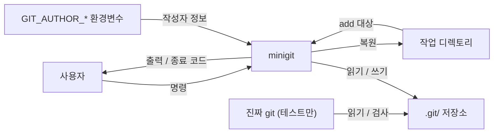
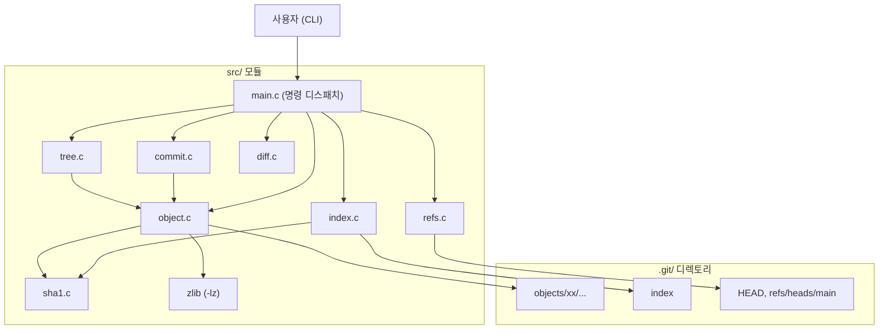
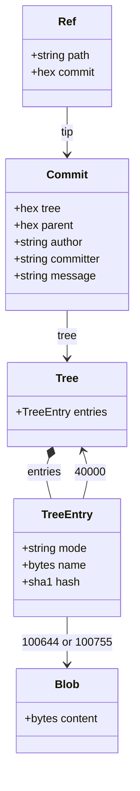
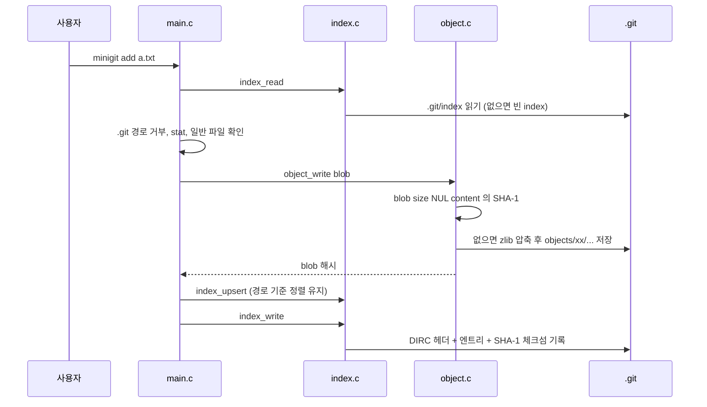
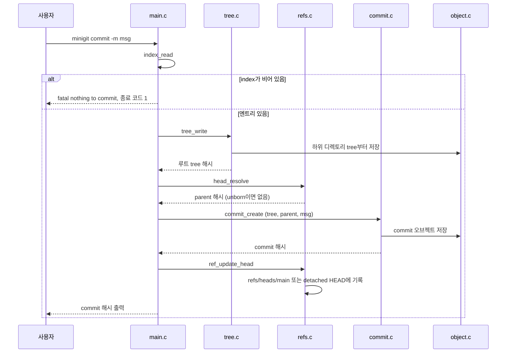
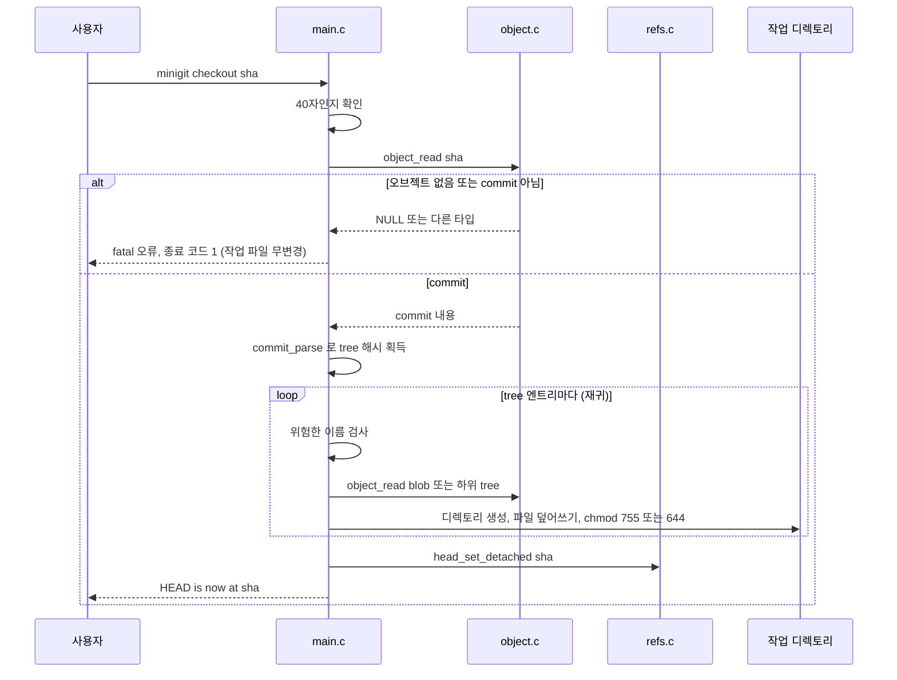
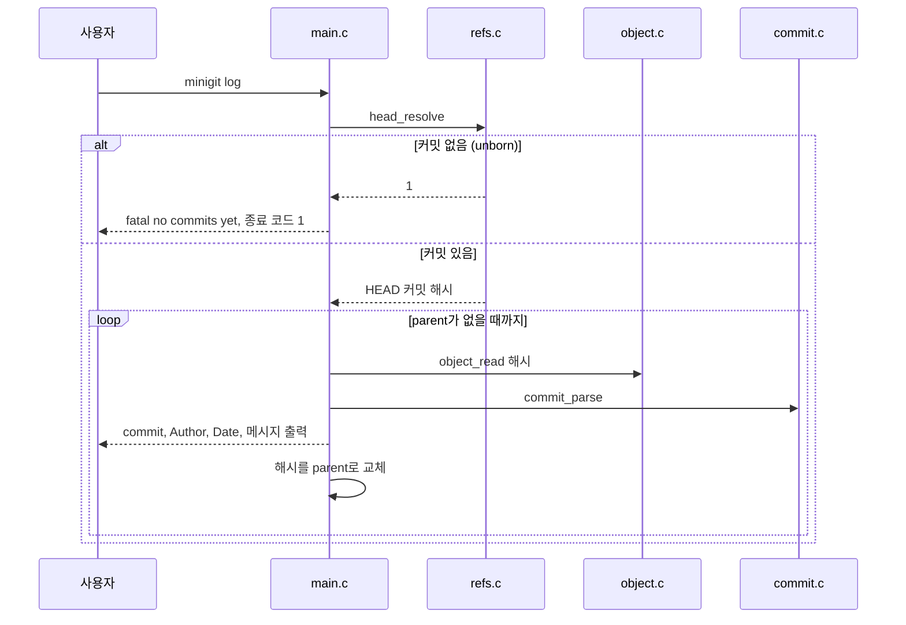
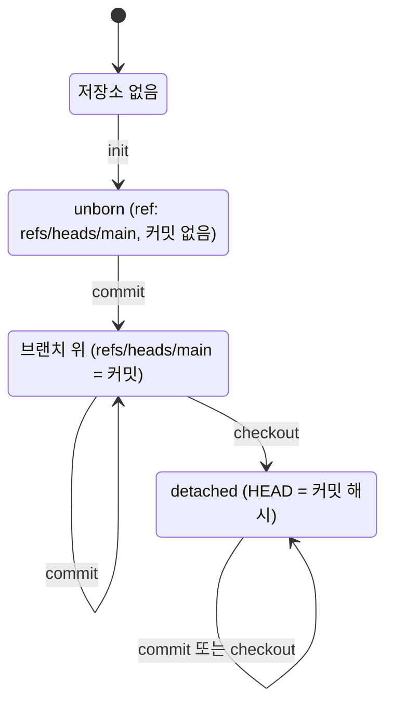

# 미니 Git 소프트웨어 설계 명세서 (SDS)

| 문서 | 버전 | 작성일 | 기준 표준 |
| --- | --- | --- | --- |
| 미니 Git 소프트웨어 설계 명세서 | 1.0 | 2026-11-18 | IEEE 1016-2009 |

## 1. 소개

### 1.1 목적

이 문서는 minigit의 설계를 설명한다. [SRS](SRS.md)의 요구사항이 어떤 모듈, 자료구조, 온디스크 포맷, 흐름으로 구현되는지 보여준다.

### 1.2 범위

minigit은 C로 만든 단일 실행 파일 CLI다. 현재 디렉토리의 `.git/` 아래에 git과 같은 포맷으로 오브젝트, index, ref를 읽고 쓴다. 외부 의존성은 zlib 하나이고, SHA-1은 직접 구현했다. 이 문서는 `src/`의 모든 모듈과 `tests/`의 검증 구조를 다룬다.

### 1.3 용어 정의

[SRS 1.4 용어 정의](SRS.md#14-용어-정의)를 따른다.

### 1.4 참고 문서

| 문서 | 내용 |
| --- | --- |
| [SRS](SRS.md) | 요구사항 명세 |
| [README](../README.md) | 개요, 빌드, 사용 예시 |
| [SPEC](../.planning/SPEC.md) | 원본 요구사항과 결정 사항 |
| [plans/](../.planning/plans/) | 단계별 구현 계획 |
| RFC 3174 | SHA-1 알고리즘 |
| git 소스 `Documentation/gitformat-index.txt` | index 포맷 |
| Eugene Myers, "An O(ND) Difference Algorithm and Its Variations" (1986) | diff 알고리즘 |

## 2. 설계 이해관계자와 관심사

| 이해관계자 | 관심사 | 다루는 뷰 |
| --- | --- | --- |
| git 내부를 배우는 독자 | 오브젝트가 어떻게 저장되고 커밋이 어떻게 이어지는가 | 3.3 논리, 3.4 정보, 3.6 상호작용 |
| 유지보수 개발자 | 모듈 경계, 함수 책임, 오류 처리 | 3.2 구성, 3.5 인터페이스, 5장 |
| 호환성 검증자 | 진짜 git과 바이트 단위로 같은가, 어떻게 확인하는가 | 3.4 정보, 6장, [SRS 4장](SRS.md#4-검증) |
| CLI 사용자 | 명령, 출력, 종료 코드, HEAD 상태 변화 | 3.1 컨텍스트, 3.5 인터페이스, 3.7 상태 동적 |

## 3. 설계 뷰

### 3.1 컨텍스트 뷰

minigit을 하나의 상자로 보면 입력은 CLI 명령과 환경변수, 출력은 `.git/` 저장소와 작업 디렉토리 파일이다. 진짜 git은 테스트에서 같은 저장소를 읽어 검사할 뿐, minigit이 호출하지 않는다.

### 3.2 구성 뷰

| 구성 요소 | 역할 | 기술 |
| --- | --- | --- |
| `src/main.c` | 서브커맨드 파싱과 실행. add / commit / log / checkout 흐름 조립 | C |
| `src/object.c` | loose object 쓰기(해시, 압축, 저장)와 읽기(해제, 헤더 파싱) | C, zlib |
| `src/index.c` | `.git/index` (index v2) 읽기, 쓰기, 엔트리 삽입 / 교체 | C, SHA-1 체크섬 |
| `src/tree.c` | index 엔트리를 디렉토리 단위 tree 오브젝트로 재귀 생성 | C |
| `src/commit.c` | commit 오브젝트 생성과 파싱 | C, 환경변수 |
| `src/refs.c` | HEAD 해석, 브랜치 ref 갱신, detached HEAD 기록 | C, 파일 기반 ref |
| `src/diff.c` | 두 파일의 라인 단위 Myers diff | C |
| `src/sha1.c` | SHA-1 (RFC 3174) | C |
| `src/util.c` | 파일 읽기 / 쓰기, hex 인코딩, `mkdir -p`, `die` (그림에서는 생략) | C |
| `.git/` | 저장소 데이터. git과 같은 포맷이라 진짜 git이 그대로 읽는다 | 온디스크 파일 |

모듈별 주요 함수:

| 모듈/파일 | 주요 함수 |
| --- | --- |
| `src/main.c` | `cmd_init`, `cmd_hash_object`, `cmd_cat_file`, `cmd_add`, `cmd_write_tree`, `cmd_commit`, `cmd_log`, `cmd_checkout`, `checkout_tree`, `tree_pretty_print`, `cmd_sha1test` |
| `src/object.c` | `object_write`, `object_read`, `object_exists` |
| `src/index.c` | `index_read`, `index_write`, `index_upsert`, `index_free` |
| `src/tree.c` | `tree_write`, `build` (재귀), `tent_cmp` (git 정렬 규칙) |
| `src/commit.c` | `commit_create`, `commit_parse` |
| `src/refs.c` | `head_symbolic_ref`, `head_resolve`, `ref_update_head`, `head_set_detached` |
| `src/diff.c` | `diff_files` |
| `src/sha1.c` | `sha1_init`, `sha1_update`, `sha1_final`, `sha1` |
| `src/util.c` | `read_file`, `write_file`, `hex_encode`, `hex_decode`, `mkdir_p`, `mkdir_parents`, `die` |

### 3.3 논리 뷰

git 오브젝트 사이의 관계:

`Commit.parent`는 직전 커밋의 해시다. 첫 커밋에는 없고, minigit은 parent를 최대 하나만 쓴다.

메모리 자료구조 (C 구조체):

| 구조체 (파일) | 필드 | 설명 |
| --- | --- | --- |
| `index_entry` (`index.h`) | `ctime_s`, `ctime_n`, `mtime_s`, `mtime_n`, `dev`, `ino`, `mode`, `uid`, `gid`, `size` (`uint32_t`), `sha[20]`, `char *path` | index 엔트리 하나. 온디스크 엔트리와 필드가 1:1 |
| `index_t` (`index.h`) | `entries`, `count`, `cap` | 경로 순으로 정렬된 동적 배열 |
| `commit_info` (`commit.h`) | `tree[41]`, `parent[41]`, `has_parent`, `author_name[256]`, `author_email[256]`, `author_date[64]`, `message` | 파싱된 커밋. `message`는 원본 버퍼 안을 가리킨다 |
| `sha1_ctx` (`sha1.h`) | `h[5]`, `len`, `buf[64]`, `buflen` | 스트리밍 SHA-1 상태 |
| `tent` (`tree.c` 내부) | `name`, `is_dir`, `mode`, `sha[20]` | tree 하나를 만드는 동안의 엔트리 |
| `edit` (`diff.c` 내부) | `op` (`-` / `+`), `idx` | Myers 역추적으로 얻은 편집 하나 |

### 3.4 정보 뷰

DB는 없다. 모든 상태는 `.git/` 아래 파일에 git과 같은 포맷으로 저장된다.

#### 3.4.1 저장소 레이아웃

| 경로 | 내용 | 쓰는 곳 |
| --- | --- | --- |
| `.git/objects/xx/yyyy...` | loose object. `xx`는 해시 앞 2자, 파일명은 나머지 38자 | `object.c` |
| `.git/index` | index v2 바이너리 | `index.c` |
| `.git/HEAD` | `ref: refs/heads/main\n` 또는 `<40자 해시>\n` | `main.c` (init), `refs.c` |
| `.git/refs/heads/main` | `<40자 해시>\n` | `refs.c` |

#### 3.4.2 loose object 포맷

| 단계 | 형식 |
| --- | --- |
| 저장 원문 | `<type> <size>\0<content>` (`type`은 `blob` / `tree` / `commit`, `size`는 content 바이트 수, 10진수) |
| 오브젝트 ID | 저장 원문 전체의 SHA-1, 소문자 hex 40자 |
| 파일 내용 | 저장 원문을 zlib `compress2(..., Z_DEFAULT_COMPRESSION)`로 압축한 바이트 |
| 쓰기 규칙 | 같은 경로 파일이 이미 있으면 쓰지 않는다 (멱등) |

압축 바이트는 zlib 레벨에 따라 git과 다를 수 있다. 그래서 호환성은 압축 해제 후 내용으로 비교한다.

#### 3.4.3 오브젝트별 content

| 타입 | content 형식 |
| --- | --- |
| blob | 파일 바이트 그대로 |
| tree | 엔트리 반복: `<mode> <name>\0<20바이트 raw SHA-1>`. 모드는 선행 0 없는 8진 ASCII (`100644`, `100755`, `40000`) |
| commit | `tree <hex>\n`, (`parent <hex>\n`), `author <name> <<email>> <epoch> <tz>\n`, `committer ...\n`, 빈 줄, 메시지. 메시지 끝에 개행이 없으면 하나 붙인다 |

commit 필드 값의 출처:

| 필드 | 1순위 | 없을 때 |
| --- | --- | --- |
| author 이름 / 이메일 | `GIT_AUTHOR_NAME` / `GIT_AUTHOR_EMAIL` | `minigit` / `minigit@example.com` |
| author 날짜 | `GIT_AUTHOR_DATE` | 현재 시각 `<epoch> <+-hhmm>` |
| committer 이름 / 이메일 | `GIT_COMMITTER_NAME` / `GIT_COMMITTER_EMAIL` | author 값 |
| committer 날짜 | `GIT_COMMITTER_DATE` | author 날짜 |

#### 3.4.4 index v2 포맷

모든 정수는 빅엔디안이다.

헤더 (12바이트):

| 오프셋 | 크기 | 필드 | 값 |
| --- | --- | --- | --- |
| 0 | 4 | signature | `DIRC` |
| 4 | 4 | version | `2` |
| 8 | 4 | entry count | 엔트리 수 |

엔트리 (엔트리 시작 기준):

| 오프셋 | 크기 | 필드 | minigit이 쓰는 값 |
| --- | --- | --- | --- |
| 0 | 4 + 4 | ctime 초 / 나노초 | `st_ctime` / 0 |
| 8 | 4 + 4 | mtime 초 / 나노초 | `st_mtime` / 0 |
| 16 | 4 | dev | `st_dev` |
| 20 | 4 | ino | `st_ino` |
| 24 | 4 | mode | 실행 비트가 하나라도 있으면 `0100755`, 아니면 `0100644` |
| 28 | 4 | uid | `st_uid` |
| 32 | 4 | gid | `st_gid` |
| 36 | 4 | size | `st_size` |
| 40 | 20 | SHA-1 | blob 해시 (raw) |
| 60 | 2 | flags | 하위 12비트 = 경로 길이 (최대 `0xFFF`), stage 0 |
| 62 | 가변 | path | 경로 바이트 + NUL 패딩. 엔트리 전체 길이가 8의 배수가 되도록 1~8바이트 |

파일 끝 (20바이트): 앞의 모든 바이트에 대한 SHA-1 체크섬.

엔트리는 경로 바이트 오름차순(`strcmp`)으로 정렬된다. 같은 경로를 다시 add 하면 자리를 그대로 두고 내용만 교체한다. 읽을 때는 헤더의 엔트리 수만큼만 읽고, 그 뒤의 바이트(확장, 체크섬)는 확인하지 않는다.

### 3.5 인터페이스 뷰

CLI 형식은 `minigit <command> [args]`다. 성공 시 종료 코드 0, 오류 시 stderr에 메시지를 쓰고 1로 끝난다. 모든 경로는 현재 디렉토리 기준(`.git/...`)이다.

| 명령 | 설명 | 출력 |
| --- | --- | --- |
| `init` | `.git/objects`, `.git/refs/heads`, `.git/HEAD` 생성 | `Initialized empty minigit repository in .git/` |
| `hash-object [-w] <file>` | blob 해시 계산, `-w`면 저장 | 40자 해시 |
| `cat-file -t\|-s\|-p <sha>` | 오브젝트 타입 / 크기 / 내용 | tree `-p`는 `<6자리 모드> <type> <hash>\t<name>` |
| `add <file>...` | blob 저장 + index 갱신 | 없음 |
| `write-tree` | index에서 tree 생성 (테스트용) | 루트 tree 해시 |
| `commit -m <msg>` | tree + commit 생성, ref 갱신 | 커밋 해시 |
| `log` | HEAD부터 first-parent 체인 출력 | 커밋마다 `commit`, `Author:`, `Date:` (`<epoch> <tz>`), 들여쓴 메시지 |
| `checkout <commit-sha>` | 커밋 tree로 작업 파일 복원, detached HEAD | `HEAD is now at <sha>` |
| `diff <fileA> <fileB>` | 라인 단위 Myers diff | 삭제는 `-줄`, 추가는 `+줄`. 공통 줄은 출력하지 않음 |
| `sha1-test` | SHA-1 테스트 벡터 3개 자가 검증 | `sha1 self-test OK` |

환경변수: `GIT_AUTHOR_NAME`, `GIT_AUTHOR_EMAIL`, `GIT_AUTHOR_DATE`, `GIT_COMMITTER_NAME`, `GIT_COMMITTER_EMAIL`, `GIT_COMMITTER_DATE` (3.4.3 표 참고).

모듈 사이의 내부 인터페이스 (헤더 기준, 반환값 0 = 성공):

| 함수 | 헤더 | 계약 |
| --- | --- | --- |
| `object_write(type, content, len, do_write, out_hex)` | `object.h` | 해시를 `out_hex`에 쓰고, `do_write`면 저장. 이미 있으면 그대로 둔다 |
| `object_read(hex, type_out, size_out)` | `object.h` | 해제한 content를 malloc 버퍼로 반환. 실패 시 NULL |
| `index_read(idx)` / `index_write(idx)` | `index.h` | index가 없으면 빈 index. 쓰기는 체크섬 포함 |
| `tree_write(idx, out_hex)` | `tree.h` | 하위 tree부터 저장하고 루트 tree 해시 반환 |
| `commit_create(tree_hex, parent_hex, message, out_hex)` | `commit.h` | 환경변수로 author / committer를 채워 저장 |
| `head_resolve(hex)` | `refs.h` | 0 = 해시 획득, 1 = unborn branch, -1 = 오류 |
| `ref_update_head(hex)` | `refs.h` | 심볼릭이면 브랜치 ref에, detached면 HEAD에 기록 |

### 3.6 상호작용 뷰

#### 3.6.1 add

파일을 blob으로 저장하고, 기존 index를 읽어 엔트리를 넣거나 교체한 뒤 index 전체를 다시 쓴다.

#### 3.6.2 commit

index에서 tree를 재귀 생성하고, HEAD가 가리키는 커밋을 parent로 삼아 commit 오브젝트를 만든 뒤 ref를 옮긴다.

#### 3.6.3 checkout (실패 경로 포함)

대상이 존재하는 commit인지 먼저 확인한 다음에만 작업 파일을 쓴다. 그래서 없는 해시로는 작업 파일이 바뀌지 않는다.

#### 3.6.4 log

HEAD를 커밋 해시로 해석한 뒤 parent가 없을 때까지 first-parent 체인을 따라간다.

### 3.7 상태 동적 뷰

코드에 있는 상태는 HEAD의 상태다. `head_resolve`의 반환값(0 / 1)과 `head_symbolic_ref`의 반환값(심볼릭 1 / detached 0)으로 구분된다.

| 상태 | `.git/HEAD` | `refs/heads/main` | `log` | `commit` |
| --- | --- | --- | --- | --- |
| 저장소 없음 | 없음 | 없음 | 오류 | 오류 |
| unborn | `ref: refs/heads/main` | 없음 | `fatal: no commits yet` | parent 없는 첫 커밋, ref 생성 |
| 브랜치 위 | `ref: refs/heads/main` | 커밋 해시 | HEAD 체인 출력 | 브랜치 ref를 새 커밋으로 |
| detached | 커밋 해시 | 그대로 | HEAD 체인 출력 | `.git/HEAD`를 새 커밋으로 |

브랜치 전환 명령이 없으므로 detached에서 브랜치 위 상태로 돌아가는 전이는 없다.

### 3.8 알고리즘 뷰

#### 3.8.1 오브젝트 쓰기 (`object_write`)

1. `"<type> <size>"` 헤더 + `\0` + content를 한 버퍼로 만든다
2. 버퍼 전체의 SHA-1을 구해 hex 40자로 바꾼다
3. 쓰기 요청이 없으면 해시만 반환한다
4. `.git/objects/xx/<38자>`가 이미 있으면 그대로 반환한다 (멱등)
5. `compress2`로 압축하고, 상위 디렉토리를 만든 뒤 파일로 쓴다

#### 3.8.2 tree 생성 (`tree.c` `build`)

index는 경로순으로 정렬되어 있으므로 같은 디렉토리의 엔트리는 연속 구간을 이룬다.

1. 구간 `[start, end)`와 현재 디렉토리 접두사 길이를 받는다
2. 각 엔트리에서 접두사 뒤 나머지 경로에 `/`가 없으면 파일 엔트리로 추가한다
3. `/`가 있으면 첫 경로 요소가 같은 연속 구간을 모아 재귀 호출하고, 반환된 하위 tree 해시를 모드 `40000` 엔트리로 추가한다
4. 엔트리를 `tent_cmp`로 정렬한다. 이름을 바이트 비교하다 한쪽이 접두사면, 디렉토리 쪽에 가상의 `/`를 붙여 비교한다
5. `<mode> <name>\0<20바이트 해시>`를 이어 붙여 tree 오브젝트로 저장한다

예: 파일 `foo.txt`와 디렉토리 `foo`는 `.`(0x2E) < `/`(0x2F)이므로 `foo.txt`가 앞에 온다.

#### 3.8.3 Myers diff (`diff_files`)

1. 두 파일을 줄 단위로 나눈다 (마지막 개행은 빈 줄을 만들지 않는다). 줄 수를 각각 N, M이라 한다
2. 편집 수 `d = 0, 1, 2, ...`를 늘려 가며, 대각선 `k = -d .. d` (2씩)마다 도달할 수 있는 가장 먼 `x`를 `V[k]`에 기록한다
   - `k == -d`이거나 `V[k-1] < V[k+1]`이면 아래로 이동(추가), 아니면 오른쪽으로 이동(삭제)
   - 그 뒤 두 줄이 같은 동안 대각선으로 전진한다 (공통 줄)
3. `x >= N`이고 `y >= M`에 닿으면 멈춘다. 이때 `d`가 최소 편집 수다
4. 각 `d`의 `V` 스냅샷(`trace`)을 거꾸로 따라가며 편집을 복원한다
5. 복원한 편집을 앞에서부터 `-줄` / `+줄`로 출력한다

시간 O((N+M)D), 메모리는 `trace` 때문에 O((N+M)D)다. linear space 개선은 쓰지 않았다.

#### 3.8.4 index 엔트리 패딩

엔트리 길이 `62 + 경로 길이`를 `(len + 8) & ~7`로 올림한다. 그래서 경로 뒤에는 항상 1~8바이트의 NUL이 붙는다 (경로의 NUL 종료 포함).

### 3.9 자원 뷰

| 자원 | 사용 방식 |
| --- | --- |
| 스레드 / 프로세스 | 단일 프로세스, 단일 스레드. 자식 프로세스를 만들지 않는다 |
| 네트워크 | 쓰지 않는다 |
| 메모리 | 파일과 오브젝트를 통째로 읽는다 (`read_file`). 오브젝트 해제 버퍼는 압축 크기의 4배 + 64바이트로 시작해 부족하면 2배씩 늘린다 |
| 파일 | 현재 디렉토리의 `.git/objects`, `.git/index`, `.git/HEAD`, `.git/refs/heads/*`, 그리고 checkout 시 작업 디렉토리 파일 |
| 고정 크기 버퍼 | 오브젝트 경로 256바이트, checkout 경로 8192바이트, tree 엔트리 이름 4096바이트, `mkdir_p` 경로 4096바이트, `commit_info`의 author 이름 / 이메일 각 256바이트 |
| 파일 권한 | checkout은 100755면 `0755`, 아니면 `0644`로 `chmod`. 디렉토리는 `0755`로 생성 |

## 4. 설계 근거

| 결정 | 대안 | 선택 이유 |
| --- | --- | --- |
| C로 구현, Makefile 빌드 | 고수준 언어 | 바이트 단위 포맷을 직접 다루며 학습 |
| SHA-1 직접 구현 (RFC 3174) | 라이브러리 (OpenSSL 등) | 학습 목적. `sha1-test`로 테스트 벡터 자가 검증 |
| zlib은 시스템 라이브러리 사용 | deflate 직접 구현 | 직접 구현하면 범위가 크게 늘어난다 |
| git index v2 바이너리 호환 | 자체 텍스트 포맷 | `git ls-files --stage`로 검증할 수 있다 |
| loose object만 사용 | packfile | 완료 조건을 loose object만으로 달성 가능 |
| 기본 브랜치 `refs/heads/main` | `master` | SPEC 확정 사항. 테스트도 `git init -b main`과 비교 |
| 작성자 정보는 git 표준 환경변수 우선, 없으면 고정값 | 설정 파일 읽기 | 고정 env로 git과 바이트 비교를 결정적으로 실행 |
| checkout은 detached HEAD + 복원 / 덮어쓰기만 | 브랜치 전환, stale 파일 삭제 | branch 기능이 범위 밖이고, 삭제는 index 대조 로직이 커진다 |
| 오브젝트 호환성은 압축 해제 후 내용으로 비교 | 압축 바이트 비교 | zlib 레벨에 따라 압축 바이트는 달라질 수 있다 |
| 테스트는 셸 스크립트로 진짜 git과 비교 | C 단위 테스트 | 호환성이 목표라 git 출력이 기준이다. 구현 내부에서는 git을 호출하지 않는다 |
| 파일 전체를 메모리로 읽음 | 스트리밍 | 학습용. 대상 파일은 수 MB 이하 가정 |
| Myers 기본형 (trace 저장 후 역추적) | linear space 개선판 | 선택 기능이고 기본형으로 최소 편집 수를 얻을 수 있다 |

## 5. 오류 처리와 엣지 케이스

오류는 `die()`로 처리한다. stderr에 `fatal: ...`을 쓰고 종료 코드 1로 끝난다.

| 상황 | 동작 |
| --- | --- |
| `.git`이 이미 있는데 `init` | `fatal: .git already exists`, 종료 코드 1 |
| `cat-file`에 없는 해시 | `fatal: not a valid object name <sha>`, 종료 코드 1 |
| `add`에 `.git` 또는 `.git/...` 경로 | `fatal: cannot add .git path`, 종료 코드 1 |
| `add`에 없는 파일 / 일반 파일이 아닌 경로 | `fatal: cannot stat` / `is not a regular file`, 종료 코드 1 |
| 같은 파일을 다시 `add` | 기존 엔트리를 교체. 중복 엔트리 없음 |
| 유니코드 / 공백 파일명 | 바이트열 그대로 저장. 인코딩 변환 없음 |
| 파일 `foo.txt`와 디렉토리 `foo`가 함께 있음 | tree 정렬에서 디렉토리에 가상 `/`를 붙여 git과 같은 순서 |
| 빈 index로 `commit` | `fatal: nothing to commit (empty index)`, 종료 코드 1 |
| 첫 커밋 (unborn branch) | parent 줄 없이 커밋, `refs/heads/main` 새로 생성 |
| detached HEAD 상태에서 `commit` | 브랜치 ref 대신 `.git/HEAD`에 새 커밋 해시를 기록 |
| 커밋 메시지 끝에 개행 없음 | 개행 하나를 붙여 저장 |
| 매우 긴 작성자 환경변수 | 버퍼를 실제 필드 길이로 잡아 잘림이나 넘침 없음 |
| 커밋 없는 저장소에서 `log` | `fatal: no commits yet`, 종료 코드 1 |
| `checkout`에 40자가 아닌 인자 | `fatal: not a valid commit hash`, 작업 파일 무변경 |
| `checkout`에 없는 해시 / commit이 아닌 오브젝트 | 오류, 종료 코드 1. tree 순회 전에 검사하므로 작업 파일 무변경 |
| tree 엔트리 이름이 `/` 포함, 빈 이름, `.`, `..`, `.git` | `fatal: unsafe tree entry name`, 작업 트리 밖이나 `.git`에 쓰지 않음 |
| 대상 커밋에 없는 작업 파일 | 삭제하지 않고 그대로 둔다 |
| `checkout` 후 index | 갱신하지 않는다. index는 checkout 전 상태로 남는다 |
| 빈 디렉토리 | add 대상이 일반 파일뿐이라 추적되지 않는다 (git과 같음) |
| `diff`에서 한쪽이 빈 파일 | 전체 `+` 또는 전체 `-` 출력 |
| `diff`에서 두 파일이 같음 | 출력 없음 |

## 6. 요구사항-설계 추적

| ID | 담당 설계 요소 (뷰/모듈) |
| --- | --- |
| FR-1 init | 3.4.1 저장소 레이아웃, 3.7 상태 동적 뷰, `main.c` (`cmd_init`) |
| FR-2 blob, hash-object | 3.4.2 loose object 포맷, 3.8.1, `object.c`, `sha1.c` |
| FR-3 cat-file | 3.4.2, 3.4.3, 3.5, `object.c` (`object_read`), `main.c` (`tree_pretty_print`) |
| FR-4 index, add | 3.4.4 index v2 포맷, 3.6.1, 3.8.4, `index.c` |
| FR-5 tree 오브젝트 | 3.4.3, 3.8.2, `tree.c` |
| FR-6 commit, refs | 3.4.3, 3.6.2, 3.7, `commit.c`, `refs.c` |
| FR-7 log | 3.6.4, 3.7, `main.c` (`cmd_log`), `commit.c` (`commit_parse`) |
| FR-8 checkout | 3.6.3, 3.7, `main.c` (`cmd_checkout`, `checkout_tree`) |
| FR-9 호환성 스위트 | [SRS 4.1](SRS.md#41-검증-방법), `tests/run.sh`, `tests/lib.sh` |
| FR-10 Myers diff | 3.8.3, `diff.c` |
| NFR-1 수 MB 이하 파일 | 3.9 자원 뷰, `util.c` (`read_file`) |
| NFR-2 오브젝트 바이트 호환 | 3.4.2, 3.4.3, `object.c`, `tree.c`, `commit.c` |
| NFR-3 index v2 호환 | 3.4.4, `index.c` |
| NFR-4 fsck 통과 | 3.4 정보 뷰 전체 |
| NFR-5 멱등 쓰기 | 3.8.1, `object.c` |
| NFR-6 결정적 실행 | 3.4.3 commit 필드 출처, `commit.c` |
| NFR-7 checkout 경로 안전 | 5장 (unsafe tree entry), `main.c` (`checkout_tree`) |
| NFR-8 단일 명령 테스트 | `Makefile` (`test`), `tests/run.sh` |
