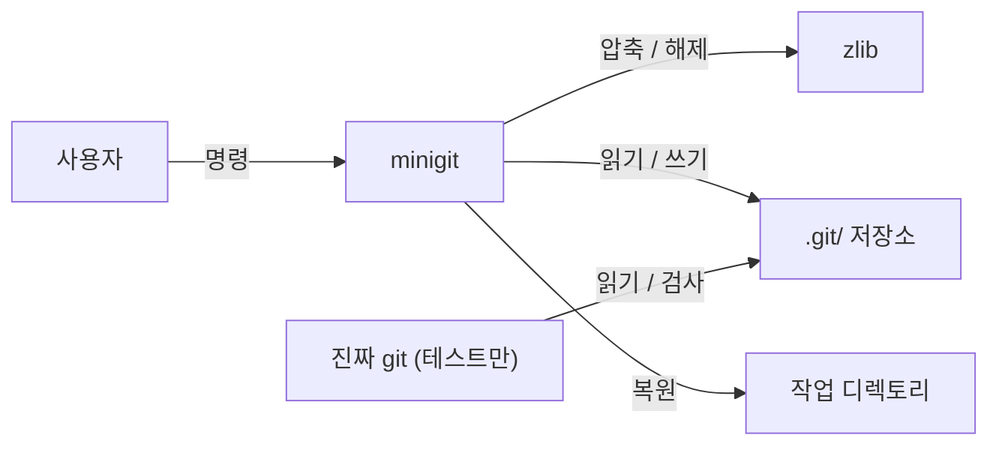

# 미니 Git 소프트웨어 요구사항 명세서 (SRS)

| 문서 | 버전 | 작성일 | 기준 표준 |
| --- | --- | --- | --- |
| 미니 Git 소프트웨어 요구사항 명세서 | 1.0 | 2026-11-18 | ISO/IEC/IEEE 29148:2018 |

## 1. 소개

### 1.1 목적

이 문서는 minigit의 요구사항을 정의한다. minigit은 C로 git의 오브젝트 모델과 핵심 명령을 구현한 CLI다. 설계는 [SDS](SDS.md)에서 다룬다.

### 1.2 범위

minigit은 로컬 저장소 하나에서 git과 같은 온디스크 포맷으로 오브젝트, index, ref를 만들고 읽는다. 완료 조건은 minigit으로 만든 저장소에서 진짜 git의 `git log`가 동작하고, `git fsck`가 오류 없이 통과하며, 같은 입력에서 만든 오브젝트가 git과 바이트 단위로 같은 것이다.

범위 내:

- 명령: `init`, `hash-object`, `cat-file`, `add`, `commit`, `log`, `checkout`, `diff`
- 보조 명령: `write-tree`(index에서 tree 생성, 테스트용), `sha1-test`(SHA-1 자가 검증)
- 오브젝트: blob, tree, commit (loose object, zlib, SHA-1)
- git index v2 읽기 / 쓰기
- refs: `.git/HEAD`, `.git/refs/heads/main` (파일 기반 loose ref)
- git과의 상호운용 테스트 스위트
- Myers diff (파일 대 파일, 선택)

범위 외 항목과 이유는 [부록 B](#부록-b-범위-외-항목)에 있다.

### 1.3 제품 개요

#### 1.3.1 제품 관점

minigit은 독립 실행 파일이다. 현재 디렉토리의 `.git/`만 읽고 쓰며, 실행 중에 git을 호출하지 않는다. 진짜 git은 테스트에서 결과를 비교하는 용도로만 쓴다.



#### 1.3.2 제품 기능

- 저장소 초기화 (`init`)
- 파일을 blob 오브젝트로 해시 / 저장 (`hash-object`), 오브젝트 조회 (`cat-file`)
- 파일을 index에 스테이징 (`add`)
- index로 tree와 commit을 만들고 브랜치 ref 갱신 (`commit`)
- HEAD부터 커밋 체인 출력 (`log`)
- 특정 커밋의 파일 복원 (`checkout`, detached HEAD)
- 두 파일의 라인 diff (`diff`)

#### 1.3.3 사용자 특성

- git 내부 구조(오브젝트 저장, 커밋 체인)를 직접 확인하려는 개발자
- 셸에서 git을 쓸 줄 알고, `git log`, `git fsck` 같은 명령으로 결과를 검사할 수 있다

#### 1.3.4 제한 사항

| 항목 | 내용 |
| --- | --- |
| 언어 | C (`-std=c11`), 빌드는 Makefile (`cc -Wall -Wextra -std=c11 -O2`) |
| 외부 의존성 | zlib(`-lz`) 하나. SHA-1은 RFC 3174 기반 직접 구현 |
| 플랫폼 | macOS 시스템 git으로 검증 |
| 테스트 환경 | `bash`, 비교용 `git`, 오브젝트 압축 해제용 `python3` |
| 파일 크기 | 수 MB 이하 가정 (전체 메모리 로드) |

### 1.4 용어 정의

| 용어 | 정의 |
| --- | --- |
| 오브젝트 (object) | `.git/objects/`에 저장되는 데이터 단위. 내용의 SHA-1 해시가 곧 이름이다 |
| content-addressable storage | 내용의 해시를 주소(키)로 쓰는 저장 방식. 같은 내용은 항상 같은 주소를 갖는다 |
| blob | 파일 내용만 담은 오브젝트. 파일 이름은 들어가지 않는다 |
| tree | 디렉토리를 나타내는 오브젝트. 엔트리마다 모드, 이름, 가리키는 blob/tree 해시를 가진다 |
| commit | 루트 tree 하나, 직전 커밋(parent), author, committer, 메시지를 담은 오브젝트 |
| loose object | 오브젝트 하나를 zlib으로 압축해 파일 하나로 저장한 형태. packfile의 반대 |
| index | `.git/index` 파일. 다음 커밋에 들어갈 파일 목록(스테이징 영역). git index v2 바이너리 포맷 |
| ref | 커밋 해시를 담은 파일. 예: `.git/refs/heads/main` |
| HEAD | 현재 위치를 나타내는 `.git/HEAD` 파일. 보통 `ref: refs/heads/main` (심볼릭 ref) |
| detached HEAD | HEAD가 브랜치 대신 커밋 해시를 직접 담은 상태. `checkout` 후의 상태 |
| unborn branch | HEAD가 가리키는 브랜치 ref 파일이 아직 없는 상태 (커밋이 하나도 없음) |
| first-parent 체인 | 각 커밋의 첫 번째 parent만 따라가는 커밋 목록 |
| Myers diff | 두 시퀀스의 최단 편집 스크립트를 O(ND)에 구하는 알고리즘 (N: 전체 길이, D: 편집 수) |

## 2. 참고 문서

| 문서 | 내용 |
| --- | --- |
| [SDS](SDS.md) | 설계 명세 (뷰, 온디스크 포맷, 모듈) |
| [README](../README.md) | 개요, 빌드, 사용 예시 |
| [SPEC](../.planning/SPEC.md) | 원본 요구사항과 결정 사항 |
| [plans/](../.planning/plans/) | 단계별 구현 계획 |
| RFC 3174 | US Secure Hash Algorithm 1 (SHA-1). `src/sha1.c`의 기준 |
| git 소스 `Documentation/gitformat-index.txt` | index 포맷 공식 문서 |
| Eugene Myers, "An O(ND) Difference Algorithm and Its Variations" (1986) | `src/diff.c`의 기준 알고리즘 |

## 3. 요구사항

### 3.1 기능 요구사항

#### FR-1 init

| 설명 | 우선순위 | 출처 | 검증 방법 |
| --- | --- | --- | --- |
| `minigit init`은 git이 유효한 저장소로 인식하는 `.git` 디렉토리를 만들어야 한다 | 필수 | SPEC R1 | 시험 |

수용 기준:
- `.git/objects`, `.git/refs/heads`, `.git/HEAD`가 생성된다
- `minigit init` 후 그 디렉토리에서 `git status`가 "not a git repository" 오류 없이 실행된다
- `.git/HEAD` 내용이 `ref: refs/heads/main` + 개행이다
- `.git`이 이미 있으면 오류 메시지를 내고 0이 아닌 종료 코드로 끝난다

#### FR-2 blob 오브젝트와 hash-object

| 설명 | 우선순위 | 출처 | 검증 방법 |
| --- | --- | --- | --- |
| `minigit hash-object [-w] <file>`은 git과 같은 SHA-1을 출력하고, `-w`면 git과 같은 오브젝트 파일을 `.git/objects/xx/yyyy...`에 저장해야 한다 | 필수 | SPEC R2 | 시험 |

수용 기준:
- 직접 구현한 SHA-1이 테스트 벡터를 통과한다 (`"abc"` -> `a9993e364706816aba3e25717850c26c9cd0d89d`)
- 임의 파일에서 `minigit hash-object` 출력이 `git hash-object` 출력과 같다
- 빈 파일의 blob 해시가 `e69de29bb2d1d6434b8b29ae775ad8c2e48c5391`이다
- `-w`로 저장한 오브젝트를 zlib 해제한 결과가 git이 저장한 것과 바이트 단위로 같다
- 같은 내용을 두 번 `-w` 해도 저장소 상태(경로, 내용)가 같다

#### FR-3 cat-file

| 설명 | 우선순위 | 출처 | 검증 방법 |
| --- | --- | --- | --- |
| `minigit cat-file -t\|-s\|-p <sha>`는 오브젝트의 타입, 크기, 내용을 git과 같게 출력해야 한다 | 필수 | SPEC R3 | 시험 |

수용 기준:
- blob에서 `-t`는 `blob`, `-s`는 크기, `-p`는 원본 내용을 출력하고 git 출력과 같다
- tree에서 `-p` 출력(모드, 타입, 해시, 이름)이 `git cat-file -p` 출력과 같다
- git이 만든 오브젝트도 `minigit cat-file`로 읽을 수 있다
- 없는 해시에는 오류 메시지와 0이 아닌 종료 코드를 낸다

#### FR-4 index와 add

| 설명 | 우선순위 | 출처 | 검증 방법 |
| --- | --- | --- | --- |
| `minigit add <file>...`은 blob을 저장하고 git의 `git ls-files --stage`가 읽을 수 있는 index v2 `.git/index`를 갱신해야 한다 | 필수 | SPEC R4 | 시험 |

수용 기준:
- `minigit add` 후 `git ls-files --stage` 출력(모드, 해시, stage, 경로)이 git으로 add 했을 때와 같다
- 수정한 파일을 다시 add 하면 엔트리가 중복 없이 갱신된다
- `dir/sub/file.txt` 같은 중첩 경로를 add 할 수 있다
- `.git` 내부 경로는 거부된다
- 파일명은 바이트열로 다룬다. 유니코드 파일명(`한글.txt`)과 공백 포함 파일명이 깨지지 않는다

#### FR-5 tree 오브젝트

| 설명 | 우선순위 | 출처 | 검증 방법 |
| --- | --- | --- | --- |
| index로 만든 tree 오브젝트는 `git write-tree` 결과와 해시 및 바이트 단위로 같아야 한다 | 필수 | SPEC R5 | 시험 |

수용 기준:
- 같은 index 상태에서 minigit tree 해시가 `git write-tree` 해시와 같다
- 엔트리 정렬이 git 규칙을 따른다. 디렉토리는 이름 뒤에 `/`가 붙은 것처럼 비교한다 (`foo`, `foo.txt`, `foo/bar` 혼재 픽스처)
- 디렉토리 엔트리 모드는 선행 0 없는 `40000`으로 기록된다
- 파일 모드는 `100644`(일반)와 `100755`(실행 가능)를 지원하고 실제 파일 권한을 반영한다

#### FR-6 commit 오브젝트와 refs

| 설명 | 우선순위 | 출처 | 검증 방법 |
| --- | --- | --- | --- |
| `minigit commit -m <msg>`는 git과 바이트 단위로 같은 commit 오브젝트를 만들고 브랜치 ref를 갱신해야 한다 | 필수 | SPEC R6 | 시험 |

수용 기준:
- 고정 환경변수(`GIT_AUTHOR_*`, `GIT_COMMITTER_*`)에서 minigit 커밋이 같은 조건의 git 커밋과 해시 및 바이트 단위로 같다
- 첫 커밋에는 parent 줄이 없고, 두 번째부터 직전 커밋이 parent로 기록된다
- 커밋 후 `.git/refs/heads/main` 내용이 새 커밋 해시 + 개행이다
- index가 비어 있으면 커밋을 거부한다 (오류 메시지 + 0이 아닌 종료 코드)
- 타임스탬프는 `<epoch> <타임존 오프셋>` 형식이다

#### FR-7 log

| 설명 | 우선순위 | 출처 | 검증 방법 |
| --- | --- | --- | --- |
| `minigit log`는 HEAD에서 시작해 first-parent 체인을 따라 각 커밋의 해시, author, 날짜, 메시지를 출력해야 한다. 형식은 git과 완전히 같지 않아도 되지만 해시와 순서는 정확해야 한다 | 필수 | SPEC R7 | 시험 |

수용 기준:
- 커밋 3개를 만든 뒤 출력된 해시 목록(순서 포함)이 `git log --format=%H`와 같다
- 각 커밋의 author 이름과 메시지가 출력에 포함된다
- 커밋이 없는 저장소에서는 오류 메시지와 0이 아닌 종료 코드를 낸다

#### FR-8 checkout

| 설명 | 우선순위 | 출처 | 검증 방법 |
| --- | --- | --- | --- |
| `minigit checkout <commit-sha>`는 해당 커밋의 tree로 작업 파일을 복원하고 HEAD를 그 해시로 바꿔야 한다 (detached HEAD) | 필수 | SPEC R8 | 시험 |

수용 기준:
- 커밋 A - 파일 수정 - 커밋 B - `checkout <A>` 후 파일 내용이 A 시점과 바이트 단위로 같다
- 중첩 디렉토리와 실행 권한(100755) 파일이 올바르게 복원된다
- checkout 후 `.git/HEAD` 내용이 해당 커밋 해시다
- 없는 해시에서는 작업 파일을 건드리지 않고 오류로 끝난다

#### FR-9 호환성 검증 스위트

| 설명 | 우선순위 | 출처 | 검증 방법 |
| --- | --- | --- | --- |
| 셸 스크립트 테스트 스위트는 git과의 호환성을 자동으로 pass/fail 판정해야 한다 | 필수 | SPEC R9 | 시험 |

수용 기준:
- minigit만으로 init - add - commit 3회 한 저장소에서 진짜 `git log`가 커밋 3개를 올바른 순서로 출력한다
- 같은 저장소에서 `git fsck`가 오류 0건이다
- 같은 입력(고정 환경변수)에서 minigit과 git의 `.git/objects` 전체 오브젝트 집합이 경로와 압축 해제 후 내용 기준으로 같다
- 단일 명령(`make test` 또는 `bash tests/run.sh`)으로 실행되고 종료 코드로 성공 여부를 알린다

#### FR-10 Myers diff

| 설명 | 우선순위 | 출처 | 검증 방법 |
| --- | --- | --- | --- |
| `minigit diff <fileA> <fileB>`는 Myers 알고리즘으로 두 파일의 라인 단위 최단 편집 스크립트를 구해 `-` / `+` 형식으로 출력해야 한다. unified diff 헤더나 hunk 병합은 하지 않는다 | 선택 | SPEC R10 | 시험 |

수용 기준:
- 같은 두 파일에서는 출력이 비어 있다
- 한 줄 삭제 + 한 줄 추가 픽스처에서 편집 라인 수가 `git diff --no-index` 기준 최소 편집 수와 같다
- 한쪽이 빈 파일이면 전체 추가 또는 전체 삭제로 출력된다

### 3.2 성능 요구사항

| ID | 요구사항 | 목표치 | 검증 방법 |
| --- | --- | --- | --- |
| NFR-1 | 파일 전체를 메모리에 올려 처리한다 | 대상 파일 크기 수 MB 이하 가정 | 분석 (측정 없음) |

### 3.3 사용성 요구사항

해당 없음. SPEC에 사용성 요구사항이 없다. 명령 이름과 인자는 git과 같은 형태를 따른다 (3.4 참고).

### 3.4 인터페이스 요구사항

| 종류 | 인터페이스 | 요구사항 |
| --- | --- | --- |
| 사용자 | CLI `minigit <command> [args]` | 성공 시 종료 코드 0, 오류 시 stderr에 메시지를 쓰고 0이 아닌 종료 코드. 명령 목록은 [SDS 3.5](SDS.md#35-인터페이스-뷰) |
| 사용자 | 환경변수 `GIT_AUTHOR_NAME`, `GIT_AUTHOR_EMAIL`, `GIT_AUTHOR_DATE`, `GIT_COMMITTER_*` | 설정되어 있으면 커밋의 author / committer에 그대로 쓴다. 없으면 `minigit <minigit@example.com>`, 현재 시각 |
| 소프트웨어 | zlib | 오브젝트 압축 / 해제에 시스템 zlib(`-lz`)을 쓴다 |
| 소프트웨어 | 진짜 git (파일 포맷 수준) | `.git/` 아래 오브젝트, index, ref를 git(SHA-1 모드)이 그대로 읽을 수 있어야 한다 |
| 통신 | 없음 | 네트워크를 쓰지 않는다 |

### 3.5 논리 데이터 요구사항

모든 데이터는 현재 디렉토리의 `.git/` 아래에 git과 같은 포맷으로 저장해야 한다. 바이트 단위 레이아웃은 [SDS 3.4](SDS.md#34-정보-뷰)에 있다.

| 데이터 | 저장 위치 | 보존 요구 |
| --- | --- | --- |
| 오브젝트 (blob, tree, commit) | `.git/objects/xx/yyyy...` | 한 번 쓴 오브젝트는 다시 쓰지 않는다 (내용 = 이름) |
| index (스테이징 영역) | `.git/index` | add 할 때마다 전체를 다시 쓴다. 끝에 SHA-1 체크섬 |
| 브랜치 ref | `.git/refs/heads/main` | 커밋할 때마다 새 커밋 해시로 교체 |
| HEAD | `.git/HEAD` | 심볼릭 ref 또는 detached 커밋 해시 |

### 3.6 설계 제약

| 제약 | 내용 |
| --- | --- |
| 해시 포맷 | SHA-1. SHA-256 오브젝트 포맷은 쓰지 않는다 |
| 오브젝트 저장 | loose object만 쓴다 (packfile 없음) |
| 기본 브랜치 | `refs/heads/main` |
| SHA-1 구현 | 직접 구현 (RFC 3174). 라이브러리 사용 안 함 |
| 압축 | 시스템 zlib 사용 |
| index 포맷 | git index v2 바이너리 |
| 테스트 | 셸 스크립트로 진짜 git과 결과 비교 |

### 3.7 소프트웨어 시스템 속성

| ID | 속성 | 요구사항 | 목표치 |
| --- | --- | --- | --- |
| NFR-2 | 이식성 (호환성) | 오브젝트(blob / tree / commit)가 git(SHA-1 모드)과 같은 온디스크 포맷 | 같은 입력에서 압축 해제 내용이 바이트 단위로 동일 |
| NFR-3 | 이식성 (호환성) | index가 git index v2 포맷 | `git ls-files --stage` 출력이 git으로 add 한 결과와 동일 |
| NFR-4 | 신뢰성 | minigit 저장소가 git 무결성 검사를 통과 | `git fsck --strict` 오류 0건 |
| NFR-5 | 신뢰성 | 오브젝트 쓰기는 멱등. 이미 있는 오브젝트는 다시 쓰지 않는다 | 두 번째 `hash-object -w` 후 오브젝트 파일 해시 변화 없음 |
| NFR-6 | 신뢰성 | 바이트 비교 테스트가 결정적으로 실행 | 고정 `GIT_AUTHOR_*` / `GIT_COMMITTER_*`로 같은 커밋 해시 재현 |
| NFR-7 | 보안 | checkout이 작업 트리 밖이나 `.git`에 쓰지 않는다 | `/` 포함, 빈 이름, `.`, `..`, `.git` 이름의 tree 엔트리는 거부 |
| NFR-8 | 유지보수성 | 전체 테스트를 명령 하나로 실행 | `make test` 하나, 종료 코드 0 = 전체 통과 |

### 3.8 금지 조건 (must-NOT)

- MN-1. minigit 구현 내부에서 `git` 명령을 호출(shell out)하지 않는다. git은 테스트 스크립트에서만 쓴다
- MN-2. 특정 입력의 해시 값을 하드코딩해 테스트를 통과시키지 않는다 (SHA-1 테스트 벡터 상수 비교는 예외)
- MN-3. checkout의 명시된 동작(복원, 덮어쓰기) 외에 사용자 파일을 삭제하거나 바꾸지 않는다
- MN-4. `.git` 밖의 경로에 오브젝트나 메타데이터를 쓰지 않는다

## 4. 검증

### 4.1 검증 방법

| 방법 | 뜻 | 이 프로젝트에서 |
| --- | --- | --- |
| 시험 | 실행해서 결과를 확인 | `tests/` 셸 스크립트. 임시 디렉토리에서 minigit과 진짜 git을 각각 실행해 출력, 해시, 오브젝트 바이트를 비교 |
| 분석 | 코드나 설계를 검토 | 측정이 없는 성능 가정 |
| 검사 | 소스를 직접 확인 | `tests/run.sh`의 `src/` grep (git 호출 여부) |

| 스위트 | 대상 | 체크 수 |
| --- | --- | --- |
| `tests/01-objects.sh` | FR-1, FR-2, FR-3 (blob) | 14 |
| `tests/02-index-tree.sh` | FR-3 (tree), FR-4, FR-5 | 8 |
| `tests/03-commit-log.sh` | FR-6, FR-7 | 10 |
| `tests/04-checkout.sh` | FR-8 | 7 |
| `tests/05-diff.sh` | FR-10 | 4 |
| `tests/run.sh` 완료 조건 시나리오 | FR-9, MN-1 | 6 |

실행:

```bash
make test     # 필요하면 빌드 후 bash tests/run.sh
```

현재 49개 체크가 전부 통과한다. 스위트 하나라도 실패하면 종료 코드 1이다.

### 4.2 요구사항 추적표

| ID | 요구사항 | 구현 위치 | 검증 근거 | 상태 |
| --- | --- | --- | --- | --- |
| FR-1 | init | `src/main.c` (`cmd_init`) | `tests/01-objects.sh` - git status, HEAD 내용, 재실행 실패 | 충족 |
| FR-2 | blob, hash-object | `src/object.c`, `src/sha1.c`, `src/main.c` | `tests/01-objects.sh` - SHA-1 벡터, git 해시 일치, 빈 blob, `-w` 바이트 비교, 멱등 | 충족 |
| FR-3 | cat-file | `src/object.c` (`object_read`), `src/main.c` | `tests/01-objects.sh` (blob, git 생성 오브젝트, 없는 해시), `tests/02-index-tree.sh` (tree `-p`) | 충족 |
| FR-4 | index, add | `src/index.c`, `src/main.c` (`cmd_add`) | `tests/02-index-tree.sh` - `ls-files --stage` 일치(중첩, 공백, 한글 경로 포함), 재add, `.git` 거부 | 충족 |
| FR-5 | tree 오브젝트 | `src/tree.c` | `tests/02-index-tree.sh` - `git write-tree` 해시 일치, 40000 / 100755 / 100644 모드 | 충족 |
| FR-6 | commit, refs | `src/commit.c`, `src/refs.c`, `src/main.c` (`cmd_commit`) | `tests/03-commit-log.sh` - 커밋 해시 체인 일치, parent, ref 내용, 타임스탬프, 빈 index 거부 | 충족 |
| FR-7 | log | `src/main.c` (`cmd_log`), `src/commit.c` (`commit_parse`) | `tests/03-commit-log.sh` - 해시 순서, author, 메시지, 커밋 없음 오류 | 충족 |
| FR-8 | checkout | `src/main.c` (`cmd_checkout`, `checkout_tree`), `src/refs.c` | `tests/04-checkout.sh` - 내용 복원, 중첩 파일, 실행 비트, detached HEAD, 없는 해시 | 충족 |
| FR-9 | 호환성 스위트 | `tests/run.sh`, `tests/lib.sh`, `Makefile` (`test`) | `tests/run.sh` - git log 순서, 커밋 수, fsck, 오브젝트 경로 / 내용 일치 | 충족 |
| FR-10 | Myers diff | `src/diff.c` | `tests/05-diff.sh` - 동일 파일, 최소 편집 수, 전체 추가 / 삭제 | 충족 |
| NFR-1 | 수 MB 이하 파일 처리 | `src/util.c` (`read_file`) | 크기별 측정이나 벤치 없음 | 미검증 |
| NFR-2 | 오브젝트 바이트 호환 | `src/object.c`, `src/tree.c`, `src/commit.c` | `tests/run.sh` 오브젝트 내용 비교, `tests/01-objects.sh` `-w` 비교 | 충족 |
| NFR-3 | index v2 호환 | `src/index.c` | `tests/02-index-tree.sh` `ls-files --stage` 비교 | 충족 |
| NFR-4 | fsck 통과 | 전체 | `tests/run.sh` `git fsck --strict` | 충족 |
| NFR-5 | 멱등 쓰기 | `src/object.c` (`object_write`) | `tests/01-objects.sh` 두 번째 `-w` 비교 | 충족 |
| NFR-6 | 결정적 실행 | `src/commit.c`, `tests/lib.sh` (`set_fixed_env`) | `tests/03-commit-log.sh` git과 커밋 해시 일치 | 충족 |
| NFR-7 | checkout 경로 안전 | `src/main.c` (`checkout_tree`) | 코드에 이름 검사만 있고 이를 확인하는 테스트 없음 | 미검증 |
| NFR-8 | 단일 명령 테스트 | `Makefile`, `tests/run.sh` | `make test` 종료 코드 | 충족 |
| MN-1 | git 호출 금지 | `src/` 전체 | `tests/run.sh` - `src/`에서 `system` / `popen` / `exec*` grep | 충족 |
| MN-2 | 해시 하드코딩 금지 | `src/` 전체 | 자동 검사 없음. 소스의 해시 상수는 `sha1-test` 벡터뿐 | 미검증 |
| MN-3 | 사용자 파일 임의 변경 금지 | `src/main.c` | 자동 검사 없음 | 미검증 |
| MN-4 | `.git` 밖 쓰기 금지 | `src/object.c`, `src/index.c`, `src/refs.c` | 자동 검사 없음 | 미검증 |

## 부록 A. 가정과 의존성

- 대상 파일은 수 MB 이하라서 전체를 메모리에 올려도 된다
- 명령은 저장소 루트(`.git/`이 있는 디렉토리)에서 실행한다. 상위 디렉토리에서 `.git`을 찾지 않는다
- 빌드에는 C 컴파일러(`cc`)와 zlib 개발 헤더가 필요하다
- 테스트에는 `bash`, `git`, `python3`가 필요하다. 바이트 비교 테스트는 `tests/lib.sh`의 고정 환경변수(`set_fixed_env`)에 의존한다
- 진짜 git은 SHA-1 오브젝트 포맷, 기본 브랜치 `main`(`git init -b main`)으로 비교한다

## 부록 B. 범위 외 항목

| 항목 | 이유 |
| --- | --- |
| packfile, delta 압축 | loose object만으로 완료 조건 달성 가능. 범위가 크게 늘어난다 |
| packed-refs, tag, annotated tag | 완료 조건에 필요 없음 |
| branch / merge / rebase, parent 2개 이상인 merge commit | DAG 학습은 log 체인으로 충분. 병합은 별도 프로젝트 규모 |
| remote, clone, push / pull 등 네트워크 | 로컬 저장소 학습이 목적 |
| `.gitignore`, `git status` | index 학습은 add로 충분 |
| symlink(120000), submodule / gitlink(160000) | 100644 / 100755 모드로 학습 목적 달성 |
| 개행 문자가 들어간 파일명 | git quoting 규칙이 복잡한 데 비해 학습 가치가 낮음 |
| 빈 디렉토리 추적 | git도 추적하지 않음. 같은 동작 |
| checkout 시 대상 커밋에 없는 파일 삭제 | index 대조 로직이 커진다. 복원과 덮어쓰기만 한다 |
| SHA-256 오브젝트 포맷 | git 기본이 아직 SHA-1. 호환 목표에 SHA-1이면 충분 |
| 대용량 파일 스트리밍 | 학습용. 파일 전체 메모리 로드 허용 |
